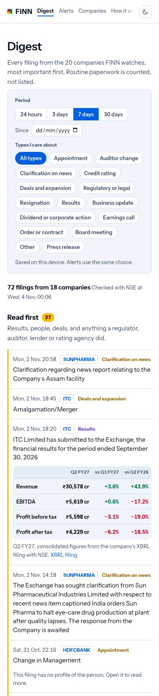
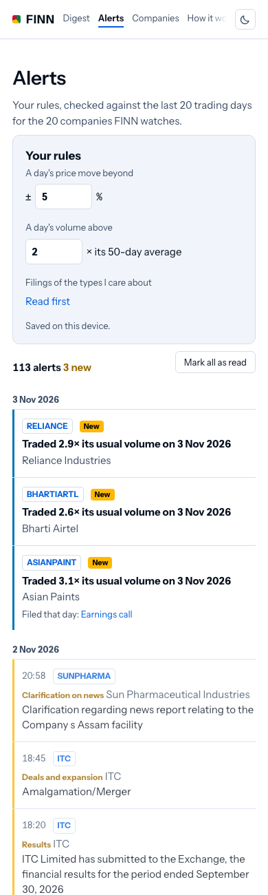
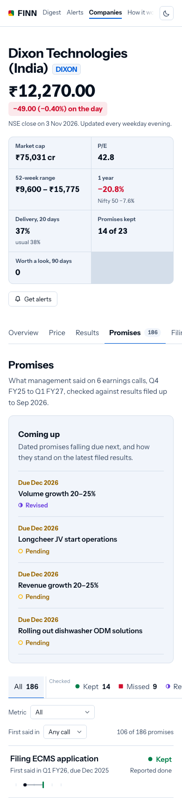
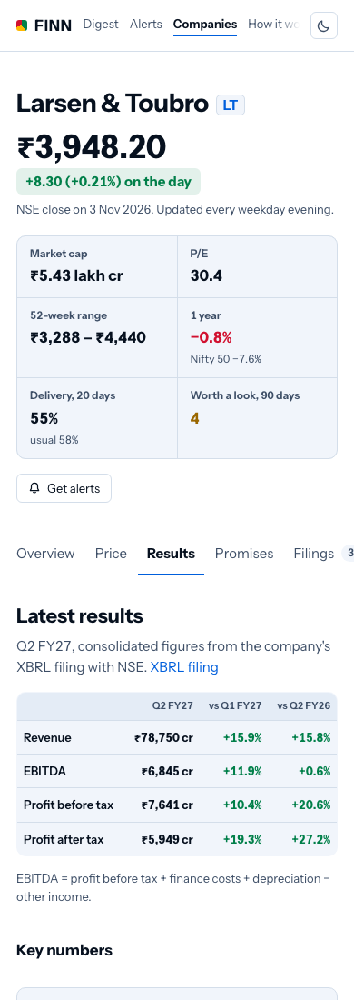

# FINN: Indian stocks, read for you

**Live:** https://finn-six-roan.vercel.app (built for a phone; open it on one)

FINN watches a 20-company NSE portfolio and tells you what changed and why it matters (push). It also checks what any
listed company's management promised on its earnings calls against what the company later filed (pull). Every number
and every quote links to the NSE document it came from. The model reads and copies; code computes every figure and decides every verdict.

<p>




</p>

## Two minutes on a phone

1. **[Digest](https://finn-six-roan.vercel.app/digest?w=7)**: every filing from the 20 companies for the window you pick (24 hours by default).
   - "Read first" holds results, people changes, deals, and anything a regulator, auditor, lender or rating agency did.
   - A results filing opens Revenue, EBITDA, PBT and PAT against the quarter before and a year before.
   - A management change shows who the person is, read from the filing itself.
   - Routine paperwork is only counted.
2. **[Alerts](https://finn-six-roan.vercel.app/alerts)**: set your own "unusual". Defaults are a ±5% day and 2× the 50-day volume. The list recomputes instantly over the last 20 sessions.
3. **[Dixon Technologies, Promises](https://finn-six-roan.vercel.app/c/DIXON#promises)**: 186 things management said they would do, across six calls, each with a verdict.
   - Open one to see the quote, the transcript page, every later mention, and the XBRL figure it was checked against.
   - On the **Price** tab, tap a call marker on the chart to see what was promised on that call.
4. **Any other company**: search, for example `HDFCBANK` (no ledger yet). Prices, results, the results card and filings are there. **Analyse** starts a ledger run for any NSE main-board company (10 to 15 minutes, one at a time).

## What maps to the brief

| Brief | In FINN |
|---|---|
| Portfolio of 15–20 | 20 companies across sectors and sizes ([finn/portfolio.py](finn/portfolio.py)), banks and an NBFC included |
| Ad-hoc research on 3–5, generalising to any ticker | Ledgers for ASIANPAINT, DIXON, KPITTECH, SUPREMEIND, TCS. Analyse runs the same engine on any NSE symbol through a GitHub Actions dispatch |
| Push: windowed digest | `/digest`: 24 h, 3 d, 7 d, 30 d or since a date; priority fixed by tag; routine collapsed |
| Push: triggered alerts, configurable | `/alerts`: your ±X% and N× volume, plus filing types you choose. Email and WhatsApp delivery is built ([docs/ALERTS_SETUP.md](docs/ALERTS_SETUP.md)); it switches on once the sending accounts exist |
| Results: Revenue, EBITDA, PBT, PAT, QoQ and YoY | From the company's XBRL filing, on the company page and under every results filing in the digest |
| Management change: who is the incoming person | The SEBI Reg 30 "brief profile" from the filing itself (not LinkedIn) |
| Pull: narrative vs numbers, last four quarters | The promise ledger: guidance from six calls vs XBRL actuals, verdicts by rule |
| Pull: financial snapshot, trajectory, guidance | Key numbers, 8–9 quarters of bars, "Coming up" (dated promises falling due) |
| Primary sources only | NSE transcripts, XBRL, bhavcopy, announcements. No news, broker notes or model knowledge |
| Mobile-first | Built at 390 px first; 7 Indian languages; light and dark |

## How it works

```
NSE (plain HTTP, ≤1 request/s, every download cached)
  ├─ bhavcopy (prices, volume, delivery)     ┐
  ├─ corporate announcements + PDFs          ├─ finn/data/      one client per source
  ├─ XBRL results (integrated + legacy)      │
  └─ earnings-call transcripts               ┘
        │
        ├─ finn/market/   prices, key numbers, results card, filing tags + priority,
        │                 big moves, new-appointee profiles                  (no model, except profile layout)
        └─ finn/ledger/   candidates → classify → thread → resolve → verdict (model classifies and copies;
                          code checks every quote verbatim, computes every actual, decides every verdict)
        │
   finn/llm.py   the only place a model is called: routing, disk cache, strict JSON, cost log
        │
GitHub Actions   every 2 h 09:00–21:00 IST + 01:00 IST: rebuild market data, rerun one stale ledger,
                 commit static JSON, send alerts       │   "Analyse" dispatches ledger.yml for any symbol
        │
web/ (Next.js on Vercel, Mumbai)   reads the committed JSON; no database (Upstash only for alert sign-ups)
```

**Models and cost.** Every model step uses Gemini 3.1 Flash-Lite:
- classifying sentences;
- linking promises across calls;
- reading later mentions;
- writing one-line explanations;
- laying out profiles.

The job is narrow (sort and copy, never compute), so a stronger model would add cost without adding accuracy. Every call is cached on disk by a hash of the prompt and schema. So far: 499 calls, 178 of them cache hits; ₹69 at paid rates; ₹0 on the free tier. See `python -c "from finn import llm; print(llm.cost_summary())"`.

**Guards that matter most:**
- A promise quote must appear word for word in the transcript.
- Every number in a target must appear in its quote.
- An actual comes from a filed XBRL tag or a formula over tags, with the tag and URL kept.
- A profile field must appear word for word in the filing.

Anything that fails is dropped, not repaired.

## Run it

```bash
python3 -m venv .venv && .venv/bin/pip install -e '.[dev]'
.venv/bin/python -m pytest -q                       # 155 tests, offline (recorded NSE fixtures)
.venv/bin/python -m finn.market --portfolio --ledgers   # prices, results, filings for the portfolio
.venv/bin/python -m finn.ledger DIXON                # a promise ledger (needs GEMINI_API_KEY in .env)
.venv/bin/python scripts/build_web_data.py           # display-ready JSON for the site
cd web && npm install && npm test && npm run dev     # 23 node tests; site on localhost:3000
```

## Repository

- `finn/`: the Python engine (data clients, market data, ledger, model gateway)
- `web/`: the site
- `tests/`: offline tests and fixtures
- `spikes/`: the data-source spikes that decided "NSE only, plain HTTP" ([docs/SPIKES_SUMMARY.md](docs/SPIKES_SUMMARY.md))
- `docs/build-history/`: the Claude Code conversation the project was built in
- `docs/WRITEUP.md`: decisions, trade-offs, what was left out, what comes next

FINN shows facts from filings, not investment advice.
